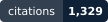
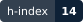
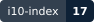
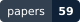
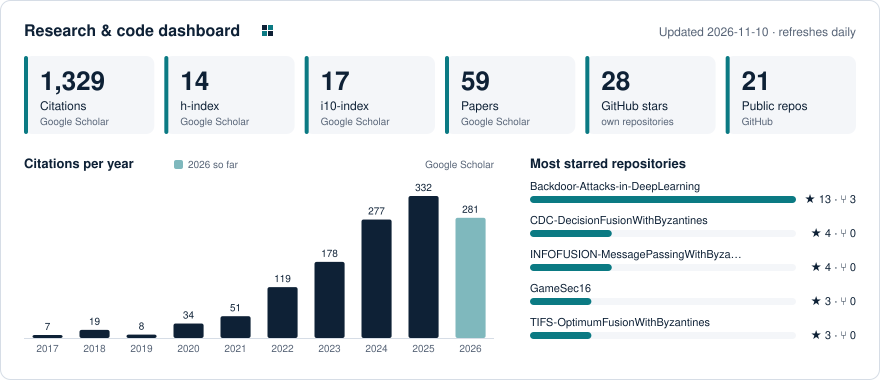

<picture>
  <source media="(prefers-color-scheme: dark)" srcset="assets/hero-dark.svg">
  
</picture>

I study how AI systems are attacked and how to make them hold: backdoor and data-poisoning attacks, model watermarking for intellectual-property protection, and secure federated learning for healthcare. I am a Senior Scientist & Junior Professor at INSERM and IMT Atlantique (LaTIM, Brest, France). Before that, I worked on AI security for defense at Inria, on AI for wireless spectrum at NIST, and on adversarial signal processing at the University of Siena.

[Website](https://sites.google.com/view/prof-dr-kassem-kallas) · [Google Scholar](https://scholar.google.com/citations?user=Bf9vAicAAAAJ) · [LinkedIn](https://www.linkedin.com/in/dr-kassem-kallas-82670954/) · [ORCID](https://orcid.org/0000-0001-7689-4125)

### Dashboard

<picture>
  <source media="(prefers-color-scheme: dark)" srcset="assets/dashboard-dark.svg">
  
</picture>

<picture>
  <source media="(prefers-color-scheme: dark)" srcset="assets/journey-dark.svg">
  
</picture>

<picture>
  <source media="(prefers-color-scheme: dark)" srcset="assets/career-dark.svg">
  
</picture>

<picture>
  <source media="(prefers-color-scheme: dark)" srcset="assets/network-dark.svg">
  
</picture>

### Publications

<!--PUBS:START-->
<!--PUBS:END-->

### Highlights

- 2nd Best Paper Award, IEEE FLTA 2026, for PARIS, a robust federated learning defense
- *Trojan Code: Adversarial Machine Learning and Secure AI Systems* (Springer, 2026)
- GHOST in IEEE TIFS 2026 · ROSE in IEEE TDSC 2026 · Mixer, ICASSP 2023 Top 3% paper
- HDR, PhD, Executive MBA · IEEE Senior Member

### Code for my papers

**AI security and backdoors**

| Repository | What it is | Venue |
|---|---|---|
| [Backdoor-Attacks-in-DeepLearning](https://github.com/KassemKallas/Backdoor-Attacks-in-DeepLearning) | Curated collection of research on backdoor attacks and defenses | Reading list |
| [strategic-safeguarding](https://github.com/KassemKallas/strategic-safeguarding) | Game-theoretic analysis of attacker and defender behavior in DNN backdoors | EURASIP JIS 2024 |
| [backdoor-cost-constraint-game](https://github.com/KassemKallas/backdoor-cost-constraint-game) | Reproducible experiments for the cost-aware backdoor attack-defense game | Experiments |
| [BackdoorAttack-ICIP2019](https://github.com/KassemKallas/BackdoorAttack-ICIP2019) | Backdoor attack on CNNs without label poisoning | IEEE ICIP 2019 |
| [MMSP19-videobackdoor](https://github.com/KassemKallas/MMSP19-videobackdoor) | Luminance-based video backdoor attack | IEEE MMSP 2019 |
| [GAN-Face-Detection-CNN](https://github.com/KassemKallas/GAN-Face-Detection-CNN) | CNN detection of GAN-generated faces | IEEE WIFS 2020 |

**Model watermarking and IP protection**

| Repository | What it is | Venue |
|---|---|---|
| [ROSE-DNN-Watermarking](https://github.com/KassemKallas/ROSE-DNN-Watermarking) | ROSE robust and secure black-box DNN watermarking | IEEE TDSC 2026 |
| [WIFS2022-RoSe-DNNWatermarking](https://github.com/KassemKallas/WIFS2022-RoSe-DNNWatermarking) | Original RoSe notebooks | IEEE WIFS 2022 |
| [mixer](https://github.com/KassemKallas/mixer) | DNN watermarking using image mixup | IEEE ICASSP 2023 |
| [RoSeMix](https://github.com/KassemKallas/RoSeMix) | RoSe-Mix black-box watermarking via image mixup | MAKE 2025 |

**Adversarial information fusion**

| Repository | What it is | Venue |
|---|---|---|
| [dl-byzantine-decision-fusion](https://github.com/KassemKallas/dl-byzantine-decision-fusion) | Deep learning for Byzantine-resilient decision fusion | IEEE Sensors J. 2025 |
| [TIFS-OptimumFusionWithByzantines](https://github.com/KassemKallas/TIFS-OptimumFusionWithByzantines) | Game-theoretic optimum decision fusion with Byzantines | IEEE TIFS 2016 |
| [INFOFUSION-MessagePassingWithByzantines](https://github.com/KassemKallas/INFOFUSION-MessagePassingWithByzantines) | Message passing for decision fusion in adversarial networks | Information Fusion 2018 |
| [MMEDIA-MessagePassingwithByzantines](https://github.com/KassemKallas/MMEDIA-MessagePassingwithByzantines) | Message passing with hidden-Markov observations | MMEDIA 2017, Best Paper |
| [CDC-DecisionFusionWithByzantines](https://github.com/KassemKallas/CDC-DecisionFusionWithByzantines) | Decision fusion with corrupted reports | IEEE CDC 2014 |
| [GameSec16](https://github.com/KassemKallas/GameSec16) | Consensus with censored data under corrupted measurements | GameSec 2016 |

### Talks

- [Backdoors in AI: Stealth Weapon or Structural Weakness?](https://github.com/KassemKallas/KeyNote_AISecurity_Backdoors_Sorbonne_CEA_Paris) Keynote, Sorbonne Université & CEA, Paris, 2025
- [HDR defense slides](https://github.com/KassemKallas/HDR_Defense_Slides), University of Western Brittany, 2025
- [Quantum Neural Networks](https://github.com/KassemKallas/QuantumNeuralNetworks), Inria Linkmedia seminar, 2022

### Work with me

Open to research collaboration, advisory roles, keynotes and senior leadership positions in AI security. Get in touch through the [contact form on my website](https://sites.google.com/view/prof-dr-kassem-kallas/contact).

Everything above is drawn by my own <a href="scripts/visuals.py">script</a> and rebuilt every day by a <a href=".github/workflows/dashboard.yml">GitHub Action</a>, with no third-party image services. Badges, dashboard, journey, career map and the publication lists all read the same data file, so the numbers always agree. Citations, h-index, i10-index and papers come from my <a href="https://scholar.google.com/citations?user=Bf9vAicAAAAJ">Google Scholar profile</a> through SerpApi (falling back to Semantic Scholar and OpenAlex if Scholar is unavailable); the collaboration map comes from OpenAlex; GitHub numbers from the GitHub API.
